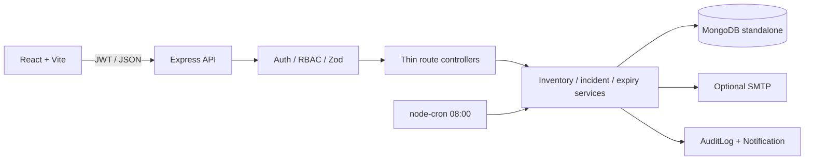
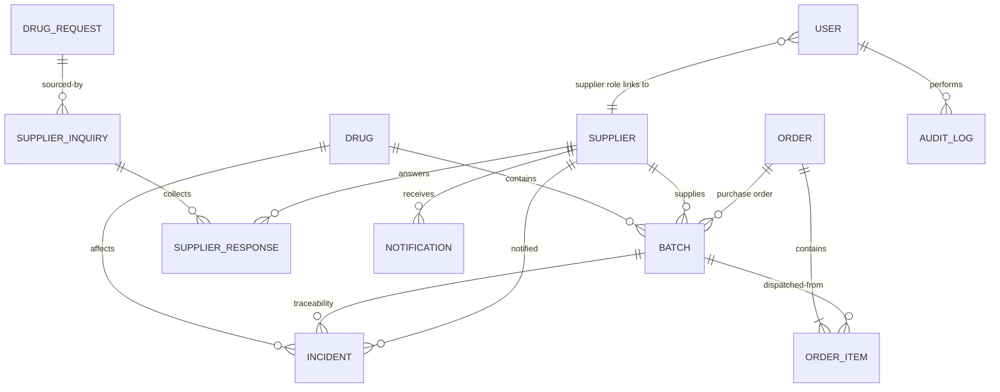
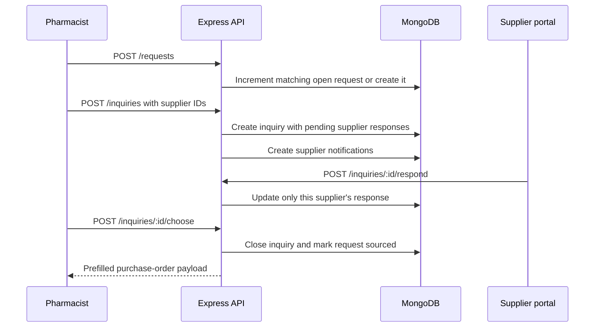

# Architecture

## System



## Core data model



## Dispatch to supplier notification

```mermaid
sequenceDiagram
  participant P as Pharmacist
  participant API as Express API
  participant S as Dispatch service
  participant DB as MongoDB
  participant I as Incident / notification service
  P->>API: POST /orders/dispatch
  API->>S: Validate and allocate FEFO batches
  loop For each FEFO batch
    S->>DB: findOneAndUpdate with stock >= quantity; decrement
  end
  S->>DB: Create dispatch order
  S->>DB: Aggregate remaining sellable stock
  alt Stockout or low stock
    S->>I: Create deduplicated incident
    I->>DB: Save incident and in-app notification
    I->>I: Attempt optional supplier email
  end
  S-->>API: Order and allocations
  API-->>P: 201 response
```

The implementation does not use multi-document transactions, so it conditionally
decrements each batch and compensates already-applied decrements if later work
fails. This is suitable for the project's standalone MongoDB setup.

## Customer demand to purchase-order draft


